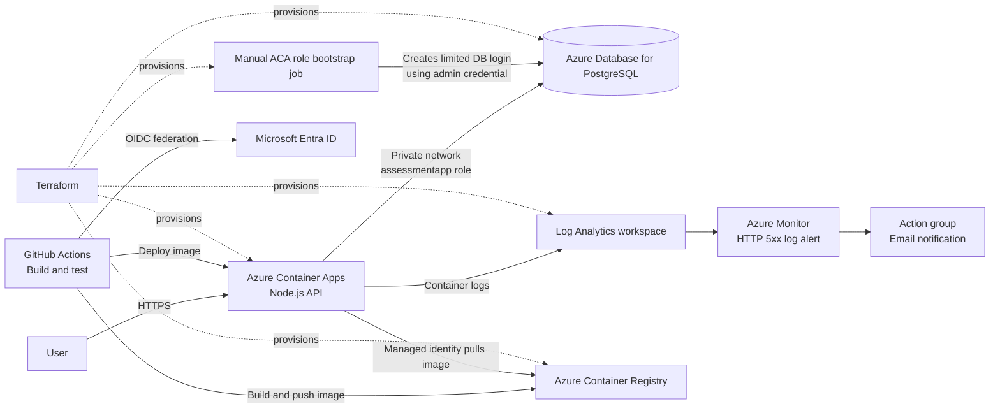
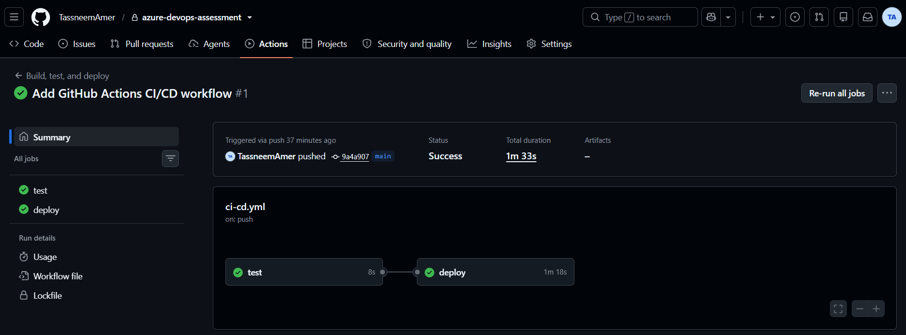
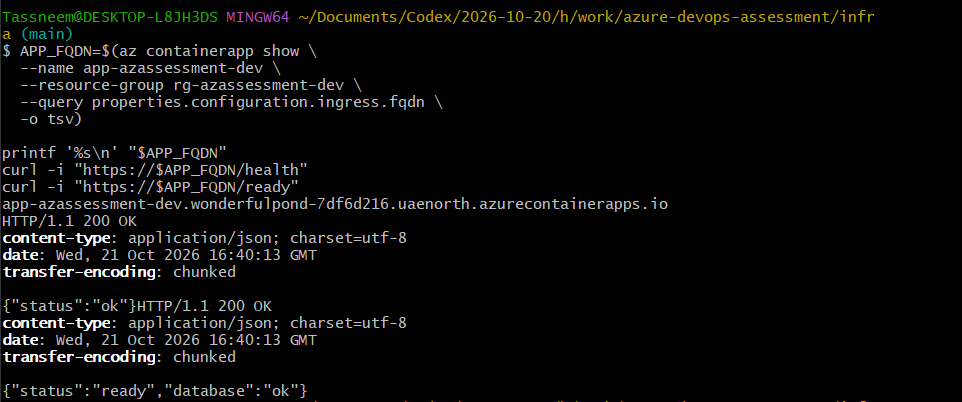
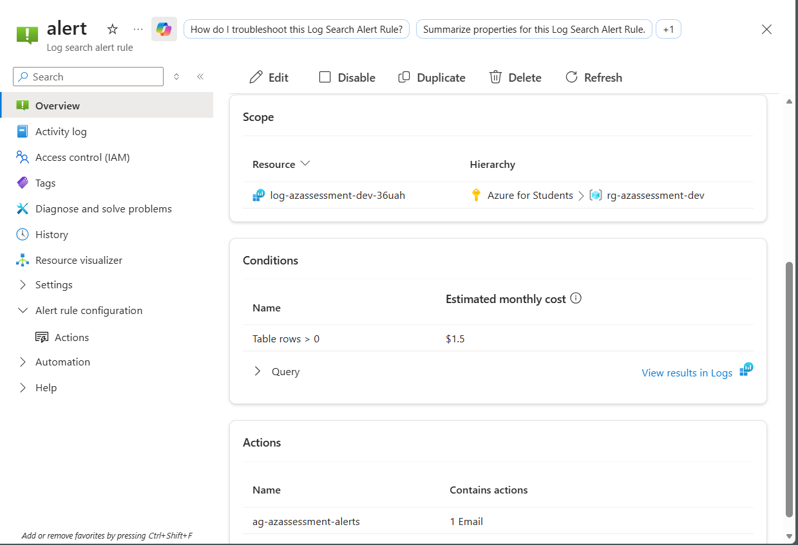
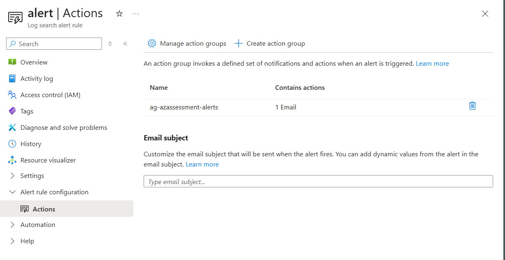

# Azure DevOps Assessment

A small API deployment demonstrating infrastructure as code, containerization, CI/CD, and basic monitoring on Azure.

## Architecture

- **API:** A small containerized API with a health endpoint
- **Compute:** Azure Container Apps
- **Database:** Azure Database for PostgreSQL Flexible Server
- **Container registry:** Azure Container Registry
- **Infrastructure:** Terraform
- **CI/CD:** GitHub Actions, with build, test, image build, and deployment on pushes to `main`
- **Monitoring:** Azure Monitor alerts and Log Analytics



See [architecture notes](docs/architecture-notes.md) for rationale and trade-offs.
Terraform files and deployment instructions are in [`infra/`](infra/README.md).

## Run locally

Requires Node.js 24 or newer.

Install dependencies:

```bash
npm ci
```

```bash
npm start
```

The API listens on port `3000` by default. Set `PORT` to change it. Visit `/` for a welcome response or `/health` for the health check.

When PostgreSQL connection settings are configured, `/ready` checks database connectivity with a simple query. It returns HTTP 503 if the database is not configured or cannot be reached.

The database-backed items API is available at `GET /items` to list items and `POST /items` to create one. Send JSON such as `{"name":"assessment demo"}` to create an item. For local PostgreSQL, create the table with `psql "$DATABASE_URL" -f app/schema.sql` before using `/items`. In Azure, the API uses the restricted `assessmentapp` database role and does not create or alter schema at runtime. Terraform configures the PostgreSQL administrator account, but the API container receives only the app-role credential; a manually triggered bootstrap job uses the administrator credential to create or update that role, prepare the table, and grant its required permissions. Terraform state and local `.tfvars` files can contain secrets; never commit or share them.

Run the basic API tests with:

```bash
npm test
```

Build and run the container from the repository root with:

```bash
docker build -t azure-devops-assessment-api .
docker run --rm -p 3000:3000 azure-devops-assessment-api
```

## GitHub Actions deployment

The workflow in `.github/workflows/ci-cd.yml` installs dependencies and runs `npm test` on pull requests and pushes to `main`. On pushes to `main`, it also authenticates to Azure with OpenID Connect, builds and pushes an image tagged with the commit SHA to Azure Container Registry, and updates the Azure Container App.

The deployed workflow uses these **repository variables** in GitHub under **Settings → Secrets and variables → Actions → Variables**:

| Variable | Value |
| --- | --- |
| `AZURE_CLIENT_ID` | Application (client) ID of `github-azure-devops-assessment` |
| `AZURE_TENANT_ID` | Directory (tenant) ID for the Azure subscription |
| `AZURE_SUBSCRIPTION_ID` | Subscription ID containing the assessment resources |

No Azure client secret is required. The Entra application must have a federated credential for this repository's `main` branch, **Container Apps Contributor** access scoped to the Container App, **Reader** on its Container Apps environment, and **AcrPush** on the registry. Terraform manages these scoped role assignments. After applying them, remove any older resource-group-scoped `Container Apps Contributor` assignment, then rerun the GitHub Actions workflow to verify the narrower permissions. The Container App's managed identity pulls the deployed image from the registry.

## Monitoring

Container Apps sends ingress logs to the Log Analytics workspace. The enabled Azure Monitor log alert checks `ContainerAppHTTPLogs` for requests to `app-azassessment-dev` with a status code of 500 or higher. It evaluates every five minutes and sends an email through the `ag-azassessment-alerts` action group when matching rows are found. No matching 5xx requests were present during the last 24-hour query check.

## Evidence

The evidence below shows a successful CI/CD run, successful API and database readiness checks after the database bootstrap job, and the configured Azure Monitor alert and email action group. The original PNG files are in [`docs/evidence/`](docs/evidence/).

<details>
<summary>View assessment evidence screenshots</summary>

**GitHub Actions:** test and deploy jobs succeeded.



The [final workflow rerun](https://github.com/TassneemAmer/azure-devops-assessment/actions/runs/39634261781) also passed both jobs after the resource-group-scoped Container Apps Contributor role was removed, verifying deployment with the narrower permissions.

**Application and database readiness:** after the PostgreSQL role bootstrap job succeeded, `/health` and `/ready` both returned HTTP 200; `/ready` reported `"database":"ok"`.



**Azure Monitor:** alert scope, query condition, and attached action group.



**Email notification:** the alert action group contains one email action.



</details>

## Status and assessment notes

The API exposes `/health` for process health and `/ready` for PostgreSQL readiness. Terraform provisions the Azure resources. GitHub Actions uses OIDC federation, builds and pushes a commit-tagged image to ACR, and updates the Container App. The [final workflow rerun](https://github.com/TassneemAmer/azure-devops-assessment/actions/runs/39634261781) passed both test and deploy after the broader resource-group role was removed. The monitoring alert is enabled and its email action group is attached.

This assessment uses the Azure for Students subscription. The PostgreSQL server is private to the virtual network, the Container App uses HTTPS ingress, and the app uses a managed identity to pull images from ACR. Terraform state and local `.tfvars` files can contain sensitive values and must stay out of source control.

## Production follow-up

For production, scale the Container App based on measured traffic and database load, define capacity limits and budgets, and use autoscaling with load testing to control cost. Improve availability with multiple app replicas across availability zones where supported, a PostgreSQL high-availability configuration, tested backups and restore procedures, and a documented recovery target. Add dashboards, service-level objectives, and alerts for latency, availability, database health, and resource saturation. These changes require a cost and reliability review before implementation.
